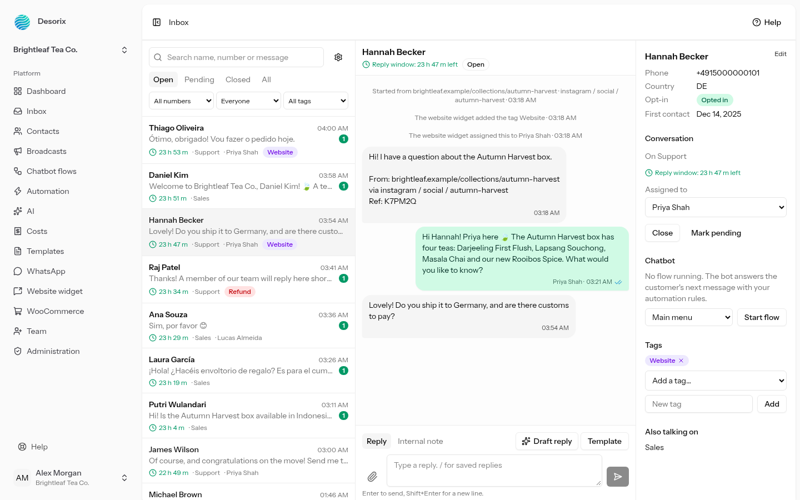
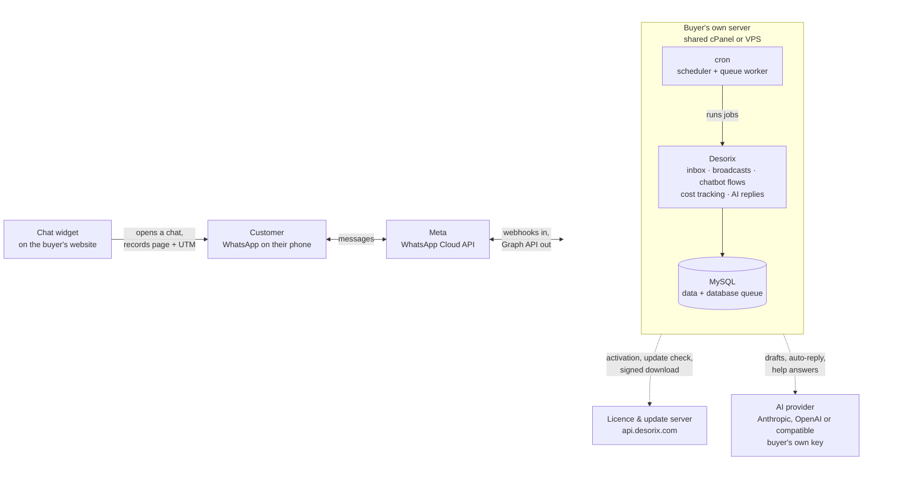
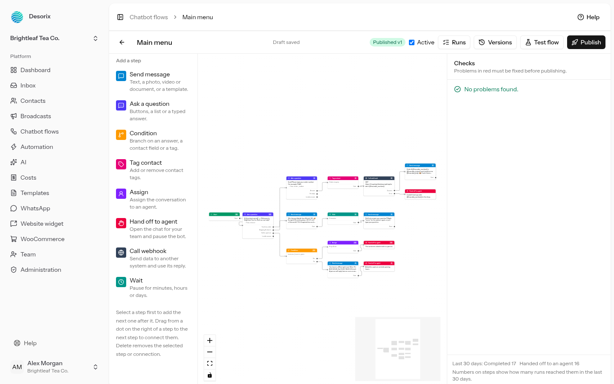
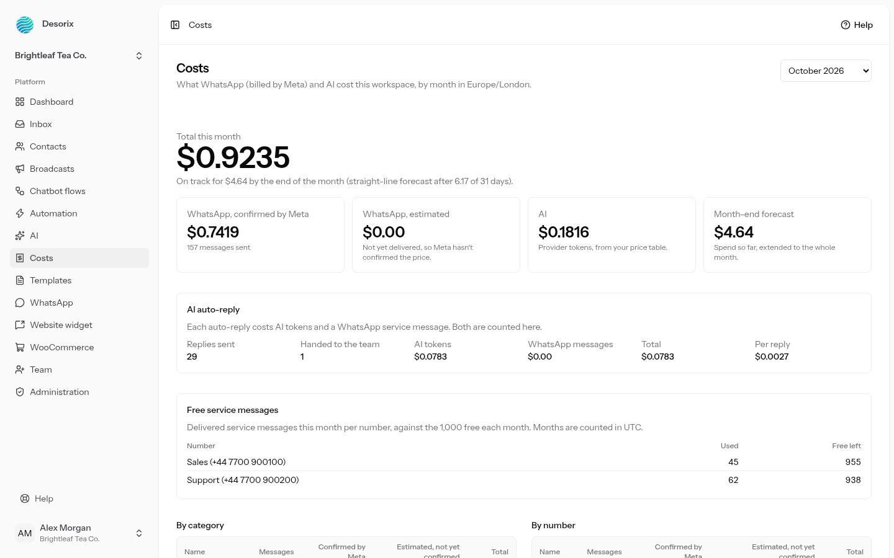
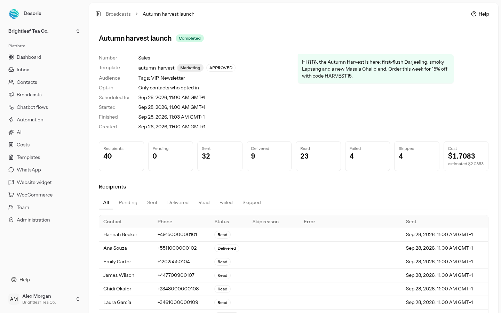
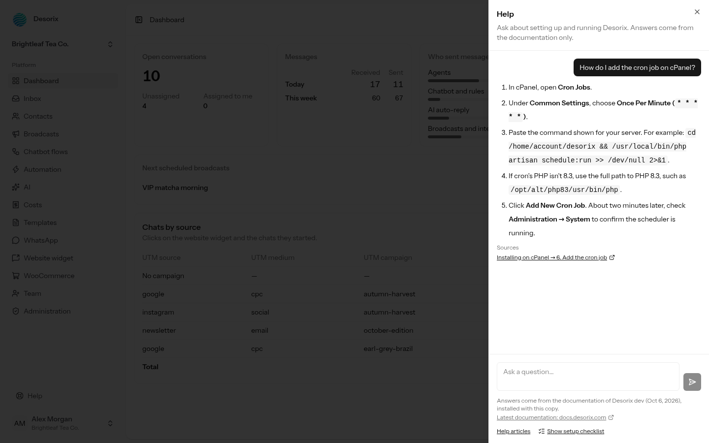

# Desorix — self-hosted WhatsApp Business platform

## What it is

Desorix is a self-hosted WhatsApp Business platform: a shared team inbox on one WhatsApp number, with broadcasts, a visual chatbot builder, AI-assisted replies, per-message cost tracking and a WooCommerce integration. Businesses install it on their own hosting and pay once; it runs on Meta's official WhatsApp Cloud API.

I designed and built all of it: the application, a separate licence and update server, the documentation site, the release and signing pipeline, the infrastructure it runs on, and the payment integration. Version 1.0.0 is complete and in private beta.

|  |  |
| --- | --- |
| Live demo | [demo.desorix.com](https://demo.desorix.com) — a seeded tea-shop account, resets nightly |
| Product site | [desorix.com](https://desorix.com) |
| Documentation | [docs.desorix.com](https://docs.desorix.com) |
| Licence server | [api.desorix.com](https://api.desorix.com) |

*The shared inbox, with the website page and campaign the chat started from shown above the first message.*

The source is private — it's a commercial product. The demo is the best way to see the work; everything in it is the real application.

## Architecture

What runs on whose server:

Everything a buyer depends on daily runs on their own hosting. My licence server is touched only when they activate a key or check for an update, so an outage there never stops anyone messaging.

The target environment drove most of the design: shared cPanel hosting, which rules out Redis, Docker, long-running processes and root access. Queues run on the database driver, realtime degrades to polling where WebSockets are unavailable, and the whole thing installs from a zip through a browser-based installer a non-developer can complete.

## The parts worth looking at

**Signed releases and in-app updates.** Buyers update from inside the app. The release zip is signed at build time with a key held offline; the installed copy verifies the signature against a public key before unpacking, takes a rollback snapshot, swaps the files, runs migrations and clears every cache. If anything fails it rolls back. Updating by FTP instead would leave stale route and config caches, so the app now checks a release marker on boot and clears them itself.

**A chatbot flow builder.** A visual editor producing a flow graph that executes server-side against incoming messages, with branching, keyword triggers, data capture and handover to a human. The bot pauses automatically when an agent replies, and resumes on request.

*The flow builder, with pre-publish checks and run counts per step.*

**Cost tracking per message.** Meta bills by conversation category and country. The app records the category, country and rate for every message, shows a monthly forecast, and enforces a spend cap for AI usage that pauses drafts and auto-replies when reached. Getting that cap genuinely hard took three passes: the first version only stopped auto-reply, the second missed the try-it box and embeddings.

*Monthly costs: WhatsApp and AI spend side by side, with a forecast.*

*A finished broadcast: per-recipient status, and actual cost against the estimate made before sending.*

**A grounded help assistant.** The shipped documentation is indexed into the database at build time; an in-app help panel searches it, sends only matching sections to the buyer's own AI model, and verifies that every section the model cites was actually one it was given. Anything unverified is replaced with an honest "I couldn't find this". A live-model test suite of 36 questions covers citation accuracy, out-of-scope refusals and prompt-injection attempts.

*The help assistant: answers come only from the shipped documentation and cite the section used.*

**Website chat widget with attribution.** A script a buyer drops on their site. When a visitor starts a WhatsApp chat, the page and campaign they came from are recorded and shown in the inbox beside the conversation.

**Bring-your-own AI key.** Anthropic, OpenAI, or any OpenAI-compatible endpoint. No platform key, so buyers control their own spend and their data doesn't pass through me.

## Infrastructure and release

Four public services, all on one Ubuntu VPS behind nginx, each isolated in its own PHP-FPM pool with its own system user and `open_basedir`, so a compromise of one cannot read another.

| Host | What it is |
| --- | --- |
| desorix.com | Static landing page, licence terms, refund and privacy pages |
| api.desorix.com | Laravel licence server: activation, signed downloads, Paystack webhook, admin |
| docs.desorix.com | VitePress documentation, built and deployed from the same repo |
| demo.desorix.com | Full application in demo mode, reseeded nightly at 03:00 UTC |

**Release pipeline.** One command builds the frontend, strips development files, signs the zip and produces two artefacts: an update package the app verifies and installs, and a buyer package with the documentation and WordPress plugin alongside it. The licence server refuses a buyer package whose inner zip is not byte-identical to the uploaded release, which catches mismatched builds before anyone downloads one.

**CI** runs Pint, PHPStan, ESLint, type checks, a translation-key check, a documentation link and anchor check, Vitest, and the PHP suite against both MySQL 8 and MariaDB 10.6. A green run on a tag publishes a demo build; on main, a staging build. Nothing deploys automatically: staging and demo are switched deliberately, which has caught more than one problem before it reached anyone.

**A WordPress plugin** ships alongside and is submitted to the wordpress.org directory. It works standalone with no licence gate, and optionally connects back to a Desorix install to carry attribution.

## Licensing, payments, distribution

The product is in private beta and not yet on public sale, so this section describes what is built and tested rather than what is in production use.

**Licence server.** Issues keys, records activations per domain, serves signed release downloads behind a short-lived link, and logs every issue, resend, reissue and download with the admin and IP behind it. A revoked or refunded licence stops receiving updates; the buyer's install keeps working, which is the right trade for self-hosted software.

**Payments.** A Paystack integration for cards and M-Pesa. The webhook verifies the signature, then confirms the payment against Paystack's own API rather than trusting the payload, so a forged body claiming the higher price cannot mint the higher licence. Events are recorded with a uniqueness constraint so a replayed delivery issues one licence and one email. Anything that doesn't match a known price waits in a queue for a human with an alert, rather than being guessed at.

**Transactional email** through Resend, with SPF, DKIM and DMARC on the domain. Scores 9.5 on mail-tester, which matters when the message carries a buyer's licence key.

**Marketplace redemption codes** are built for later: campaigns, bulk code generation, CSV export, a public redeem page, per-campaign tracking of issued, redeemed and refunded.

**Rate limiting** on every public endpoint. Failed sign-ins to the download page lock that email for an hour, cleared by a correct attempt so a buyer's own typos don't lock them out; a flood across many addresses raises an alert and tightens the per-IP limit.

## Three problems, and how they went

**A help assistant that answered confidently from the wrong page.** The first version retrieved documentation by keyword and let the model answer from whatever came back. Asked "how do I import contacts from a CSV", it quoted a page introduction and dropped the actual steps. I measured it properly rather than fixing the one case: of 22 buyer-phrased questions, only 10 retrieved the right section. The causes were vague headings that shared no words with how a buyer asks, internal developer pages crowding the results, and no relevance floor. Renaming 23 headings and excluding the architecture page took it to 19 of 22, and a new prompt rule — a section that merely mentions a topic is not an answer to it — stopped the remaining misses becoming confident wrong answers. Then I wrote ten held-out questions and refused to tune against them: 6 clean, 2 thin, 2 honest "couldn't find this", no wrong answers.

**A spend cap that wasn't a cap.** The AI spend limit was advertised as a hard ceiling. It stopped auto-replies and nothing else. Manual testing found drafts sailing past it; investigating further found the try-it box and document embedding doing the same. Every path that spends now checks first. The lesson I took: an advertised guarantee needs a test per path, not per feature.

**A production server with someone else's ransom note on it.** During infrastructure work I found an unexplained compromise on the box from four months earlier — encrypted files in root's home, a ransom page served at the apex domain because no vhost existed to catch it. Nothing of the application was touched and the attack had failed, but it changed what I did next: isolated PHP-FPM pools per service, a vhost for every hostname in DNS so nothing falls through to a default, credentials rotated out of plaintext crontabs, and a documented rule that every DNS name gets its own certificate.

## Scope

|  |  |
| --- | --- |
| Automated tests | 740, passing on MySQL 8 and MariaDB 10.6 |
| Files in a release | 12,562 |
| Languages | English and Arabic, right-to-left throughout |
| Documentation | 24 pages, with a link and anchor check in CI |
| Recorded decisions | 153, each with the alternatives considered |
| Build time | Roughly three weeks, solo |

Static analysis at PHPStan's strictest level, Pint for formatting, and architecture tests that fail the build if the two AI subsystems import each other, with marker-word tests proving neither one's knowledge base can reach the other's prompt.

Every significant decision is written down with what was chosen, why, and what was rejected. That turned out to matter more than any single piece of code: it is what made it possible to come back to a part of the system weeks later, or reverse a plan when a marketplace closed, without re-deriving the reasoning.
